## Lab 3: Keypad Scanner

### Introduction

In this lab, I used an FPGA to scan inputs from a keypad. I designed a circuit interface to read this matrix keypad, implemented a solution to deal with switch bouncing, and implemented digital design strategies to ensure appropriate behavior with a variety of different user inputs (for example, like two keys pressed at once).

### Design and Testing Methodology
I made a variety of different modules in order to implement the keypad scanning functionality. The columns of the keypads are inputs and the rows are outputs. Two main FSMs were implemented in order to get the keypad functionality to truly work: the debouncer FSM and the scanning FSM. 

#### State transition diagrams and tables 
::: {.callout-note collapse="true"}
## FSMs

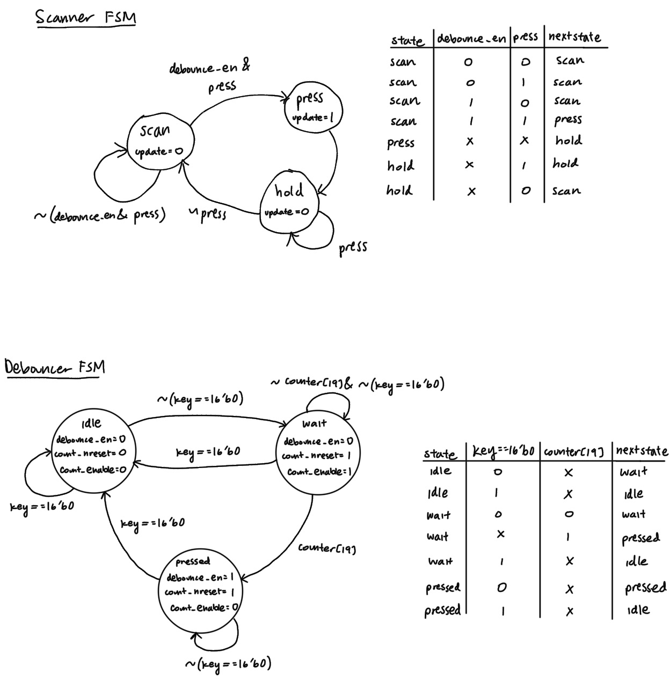

Figure 1: State transition diagrams for the FSMs.
:::

#### FSM Partitioning, Switch Debouncing Strategy, and Tradeoffs
The debouncer FSM handles switch debouncing by checking to see if the pressed key stayed down for 10.9 ms, and if it does then the physical key press was actually a real press. Otherwise, the display will not be updated. The reason we need a debouncer FSM is to prevent false detections caused by switch bouncing, which can occur when a key is pressed or released. This FSM outputs a debounce_en signal, which indicates that at least one key is really pressed and that the switch is no longer bouncing. We don't have to worry about filtering out super short clicks on accident, since physically any press would last longer than the switch bouncing period.

By implementing this debounce FSM, the signals are clearly distinguished and only requires at most 3 states. Other designs could include less FSMs with more states, which can cause the state transitions to become more complex and harder to manage. It's generally much easier to create something by breaking it into smaller pieces (more FSMs) rather than trying to do it in one go (less FSMs with more states).

The scanner FSM works by checking to see if a key has been pressed. It relies on the debounce_en outputted from the debouncer FSM as part of this decision-making. If a press is detected (while also ensuring that a debounce has occurred), then the update will occur. This update will allow the value to be shown on the seven-segment display.

#### Testing the Design
I used testbenches to test the design, which is explained in the Results and Discussion section. I also tested the design on hardware by pressing a combination of buttons and visually observing the output on the seven-segment display.

#### No latches and no tristate buffers
::: {.callout-note collapse="true"}
## Output files

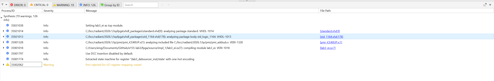

Figure 2: Synthesizer output files showing no latches and no tristate buffers.
:::

The synthesizer output files in [Figure 2](images/synthesizer_output_files.png) demonstrate that the design has no latches and no tristate buffers.

### Technical Documentation

The source code for this lab can be found in [this GitHub repository](https://github.com/eing523/e155-lab3).

#### Block Diagram 

::: {.callout-note collapse="true"}
## Top Module Block Diagram

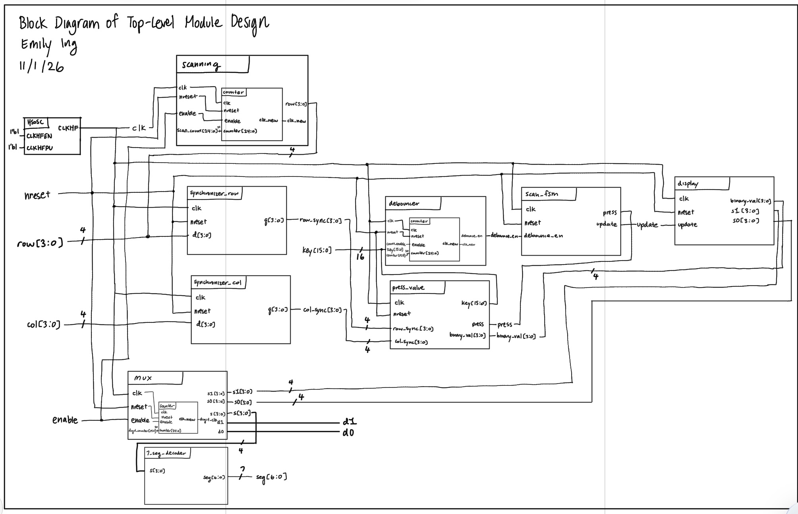

Figure 3: Block diagram of the top module design.
:::

The block diagram in [Figure 3](images/top_blockdiagram.jpeg) demonstrates how the top module brings all submodules, including the scanner FSM and debouncer FSM, together.

::: {.callout-note collapse="true"}
## Press Value Module Block Diagram

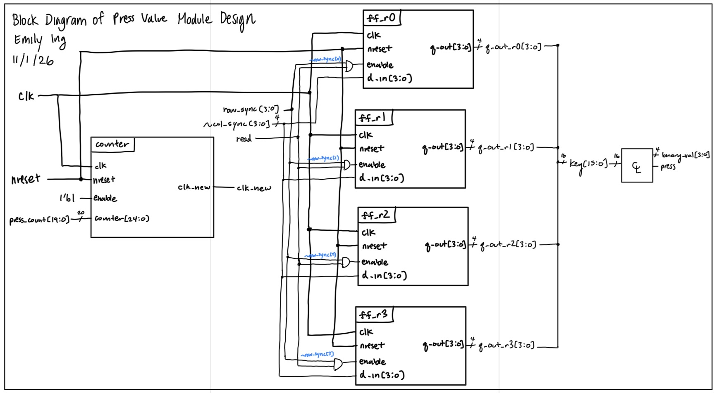

Figure 4: Block diagram of the press value module design.
:::

The block diagram in [Figure 4](images/pressvalue_blockdiagram.jpeg) demonstrates how the press value module works. This module tells us which value is being selected, and that value will be chosen to be displayed on the display.

#### Schematic

::: {.callout-note collapse="true"}
## Keypad Schematic
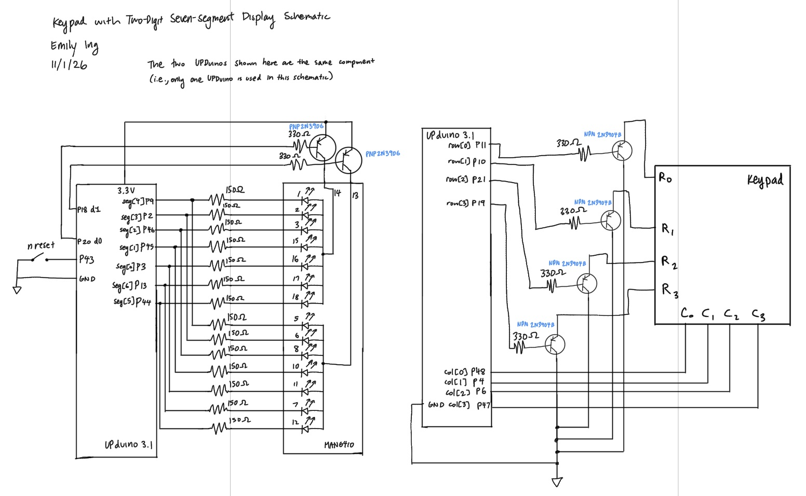

Figure 5: Schematic of the physical circuit.
:::

The schematic in [Figure 5](images/schematic.jpeg) shows how the circuit is physically connected.

The resistor values are the same as the ones used in Lab 2, found in the same manner.

### Results and Discussion

#### Testbench Simulation

::: {.callout-note collapse="true"}
## Top-level module functionality
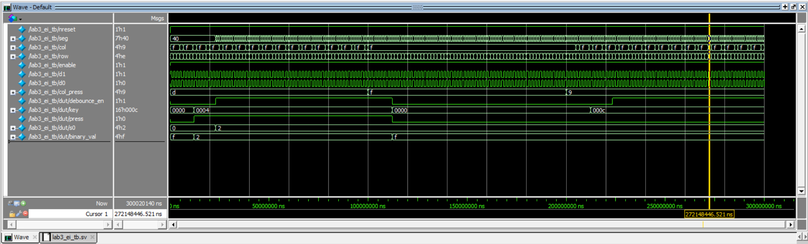
Figure 6: Simulation waveforms for the top level module functionality.

:::
The waveforms in [Figure 6](images/top_tb.png) show a successful testbench run for the top level module.

::: {.callout-note collapse="true"}
## Scanning FSM functionality
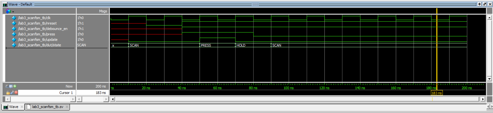

Figure 7: Simulation waveforms for the scanning FSM functionality.
:::
The waveforms in [Figure 7](images/scanfsm_tb.png) show a successful testbench run for the scanning FSM functionality.

::: {.callout-note collapse="true"}
## Debouncer FSM functionality
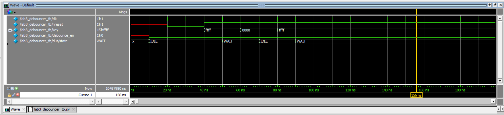

Figure 8: Simulation waveforms for the debouncer FSM functionality.
:::
The waveforms in [Figure 8](images/debouncer_tb.png) show a successful testbench run for the debouncer FSM functionality. The debouncer is used to prevent reading switch bounce.

::: {.callout-note collapse="true"}
## Press value functionality
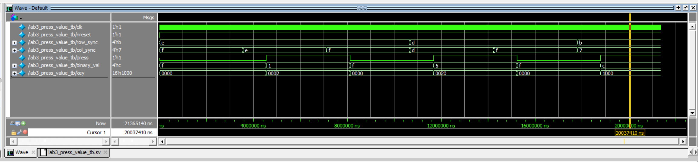

Figure 9: Simulation waveforms for the press value functionality.
:::
The waveforms in [Figure 9](images/pressvalue_tb.png) show a successful testbench run for the press value functionality.

::: {.callout-note collapse="true"}
## Press logic functionality
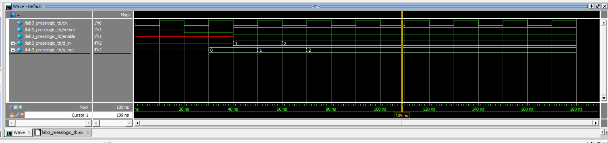

Figure 10: Simulation waveforms for the press logic functionality.
:::
The waveforms in [Figure 10](images/presslogic_tb.png) show a successful testbench run for the press logic functionality. This module allows us to determine what four column bits are associated with one row.

::: {.callout-note collapse="true"}
## Scanning module functionality
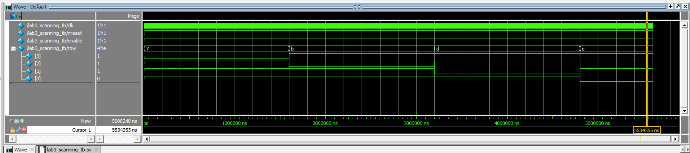

Figure 11: Simulation waveforms for the scanning module functionality.
:::
The waveforms in [Figure 11](images/scanning_tb.png) show a successful testbench run for the scanning module functionality. The scanning module looks goes through each row of the keypad, checking for key presses and updating the corresponding signals accordingly.

::: {.callout-note collapse="true"}
## Display module functionality
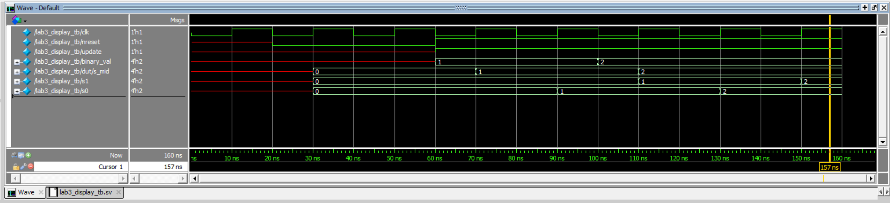

Figure 12: Simulation waveforms for the display module functionality.
:::
The waveforms in [Figure 12](images/display_tb.png) show a successful testbench run for the display module functionality. This module is used to keep track of which values are being displayed on the seven-segment display, including shifting the digits appropriately as new inputs come in.

::: {.callout-note collapse="true"}
## Multiplexer module functionality
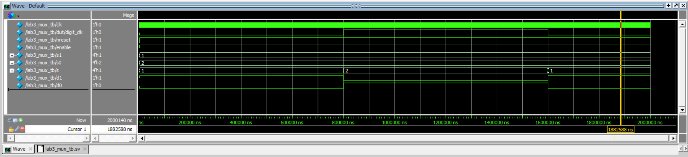

Figure 13: Simulation waveforms for the multiplexer module functionality.
:::
The waveforms in [Figure 13](images/mux_tb.png) show a successful testbench run for the multiplexer module functionality. The mux is used to determine which digit lights up on the display on each clock tick, switching at a rate fast enough such that the human eye cannot see the flicker.

::: {.callout-note collapse="true"}
## Synchronizer functionality
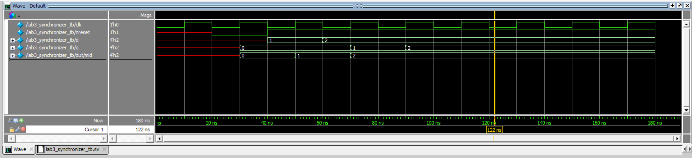

Figure 14: Simulation waveforms for the synchronizer functionality.
:::
The waveforms in [Figure 14](images/synchronizer_tb.png) show a successful testbench run for the synchronizer functionality. The synchronizer is used to handle metastability for the column input from the keypad. This module is also used on the rows output to ensure that the rows output gets the same two-tick delay as the columns.

The counter and seven-segment display modules were tested succesfully in the previous lab, so please refer to that lab report for those testbench waveforms.

Overall, due to the success of all testbenches, I can confidently say that the code works as intended. This is further verified by the fact that the hardware testing works exactly as expected.

### Conclusion

Using SystemVerilog and Lattice Radiant, I was able to create code that successfully allows us to control a 2-digit 7-segment display (showing hexadecimal digits) using keypad inputs.

The design meets all the requirements. Overall, the lab was a success!

I spent a total of 40 hours working on this lab.

### AI Prototype Summary

I used Gemini to produce code. Given the first prompt, I copy-pasted the code it gave into Lattice Radiant. It didn't synthesize on the first try, and when I gave the error message back to the AI, it found that there was a random stray line that contained the words "1 me", which I found really weird (I wonder if the AI was getting confused as it was thinking of a response). After telling the AI to correct this error, I synthesized the code again and it was a success. For prompt 2, the code didn't synthesize on the first try. The first error it threw up was because it was using an older tool (SB_HFOSC) that isn't used in Lattice Radiant anymore. After this the code had no issues, except for the message that it was instantiating an unknown module sevenSegment. This is okay, though, since we explicitly told the LLM to assume that this module exists. So I would say that the code was a success after this one mistake.

Overall, when it comes to comparing the two styles, they performed pretty similarly; the errors generated in Lattice Radiant were very minor and one was not significantly worse than the other. I think something to point out, though, is that there is a chance that the AI could produce more nonsense if faced with a monolithic prompt, just because there was a random "1 me" line that doesn't make sense in any SystemVerilog context. To compare, the error generated from the modular prompts were more sensible, meaning that one could understand where this error was coming from.