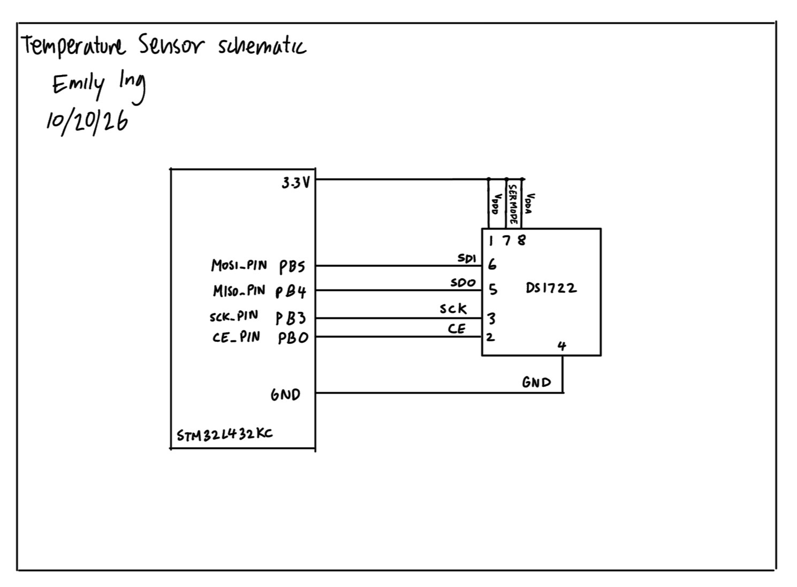
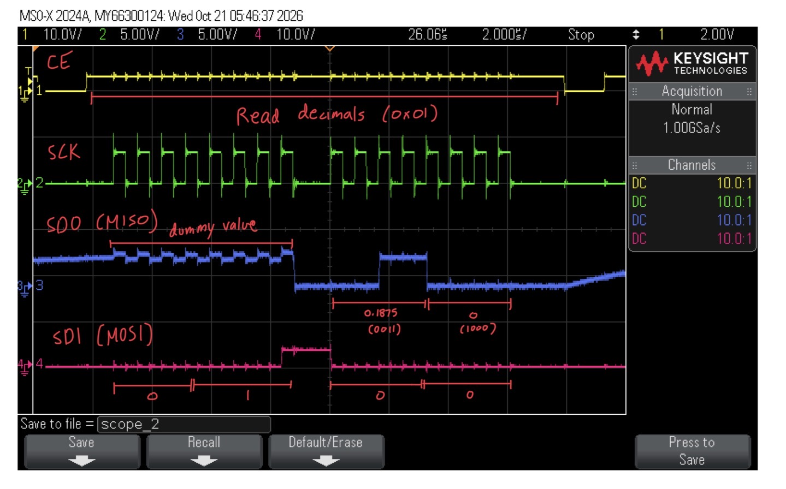
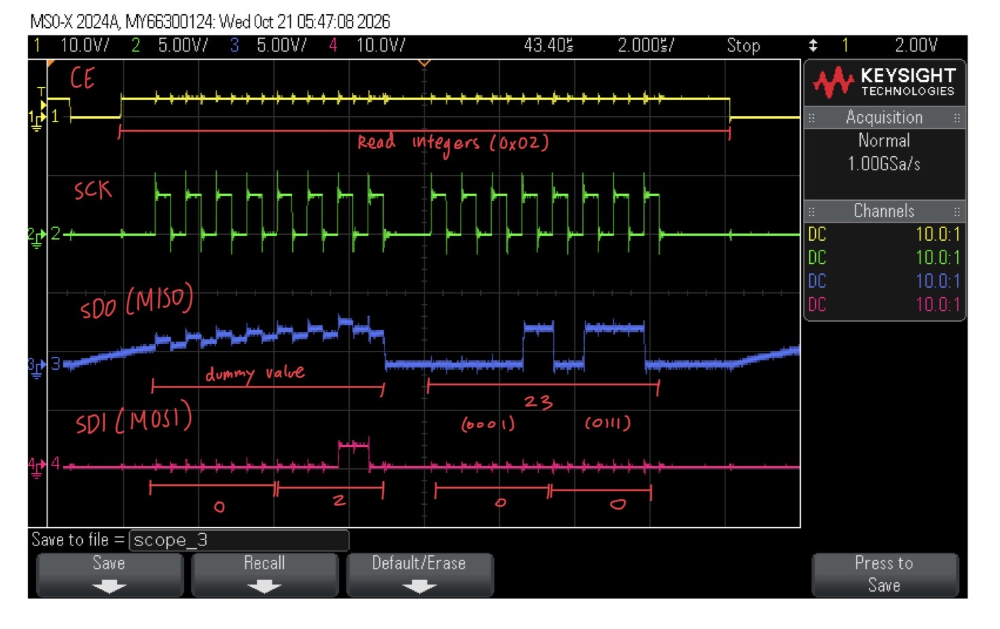

## Lab 6: The Internet of Things and Serial Peripheral Interface

### Introduction

This lab aims to design and build an IoT device and inferface a temperature sensor module over an SPI link. This lab also aims to interface the MCU with an ESP8266 module over a UART link. Finally, a simple HTML page is written to control and display temperature data and an LED status from the peripherals connected to the MCU.

### Design and Testing Methodology

I had to create a .c and .h file for the temperature sensor (DS1722) and for SPI logic. Additionally, in the main.c file, I had to write code for a simple HTML page, resolution control, and for displaying the temperature and LED data.

#### Testing the Design
To test the design, I used an oscilloscope to ensure that the SPI read and write transactions were working by checking that the observed timing matches the temperature sensor datasheet's specified SPI timing. I also pressed the multiple buttons that change bit resolution on the HTML page to ensure that the temperature data was being displayed according to the selected resolution.

### Technical Documentation

The source code for this lab can be found in [this GitHub repository](https://github.com/eing523/e155-lab6).

#### Schematic

::: {.callout-note collapse="true"}
## Temperature Sensor Schematic

Figure 1: Schematic of the physical circuit (temperature sensor).
:::

The schematic in [Figure 1](images/schematic.jpeg) shows how the temperature sensor circuit is physically connected.

For the STM32L432KC we have PB5 (MOSI_PIN) connected to SDI since MOSI means that the slave is receiving the master's output, and therefore means that the temperature sensor is receiving an input. We have PB4 (MISO_PIN) connected to SDO since MISO means that the master is receiving information from the slave, and therefore means that the temperature sensor is sending out an output to the MCU. See the [motherboard schematic](https://hmc-e155.github.io/assets/doc/E155%20FA22%20Development%20Board%20Schematic.pdf) for these pin locations. Pin 7 of the DS1722 is connected to 3.3 V since we want SPI enabled.

### Results and Discussion

The temperature data on the HTML page was displayed correctly and the LED status was also displayed correctly. The SPI transactions were also verified to be correct using an oscilloscope. However, I notice that when I press the resolution buttons too quickly the temperature data doesn't immediately change to the correct resolution, and I believe this is because of the conversion time for each resolution as mentioned in the DS1722 datasheet. The greater the bit resolution, the longer the conversion time. Therefore, I think the sensor can get confused if the resolution is changed too quickly, and it may not have enough time to complete the conversion before the next resolution change.

#### Logic Analyzer Capture of Full SPI Read Transaction
::: {.callout-note collapse="true"}
## Reading LSB (Decimal)

Figure 2: Capture of the LSB (Decimal) reading.
:::

[Figure 2](images/lsb.jpeg) shows the LSB being read. By using the DS1722 datasheet, we can tell what value is being read on each clock tick, as annotated.

::: {.callout-note collapse="true"}
## Reading MSB (Integer)

Figure 3: Capture of the MSB (Integer) reading.
:::

[Figure 3](images/msb.jpeg) shows the MSB being read. By using the DS1722 datasheet, we can tell what value is being read on each clock tick, as annotated.
 
### Conclusion

Using SEGGER and C, I was able to use an MCU to implement SPI functionality and interface it with an ESP8266 module over a UART link. I was also able to interface a temperature sensor module over an SPI link. As a result, temperature and LED data was displayed successfully on the HTML page.

The design meets all the requirements. Overall, the lab was a success!

I spent a total of 20 hours working on this lab.

### AI Prototype Summary

I used Gemini for this exercise. For the first prompt, the result made my website look more detailed, professional, and interactive. For example, there is a graph that updates the temperature every few milliseconds and shows the data in real-time. There's also smoother transitions between user actions and animations. Overall, the output makes sense because it shows relevant temperature data, but one feature it included that didn't make sense was changing the LED color. Upon using the second prompt, the performance wasn't terrible but had a few issues. For example, the code would sometimes reference the wrong address, since I didn't give it a datasheet to reference. Something that it did well was understand the process of chip enabling and doing some action while the chip enable was on. It doesn't work when plugged into the project, since the main file couldn't find the names of these functions.