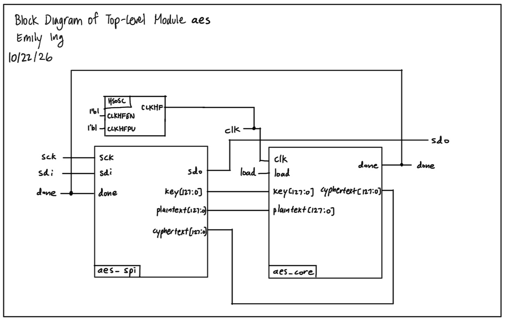
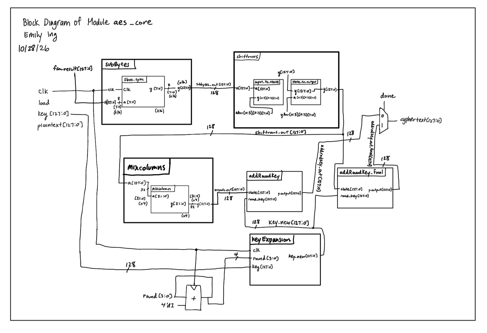
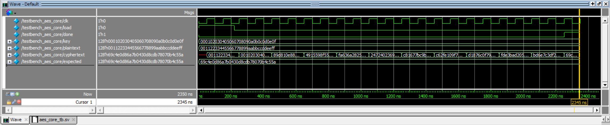
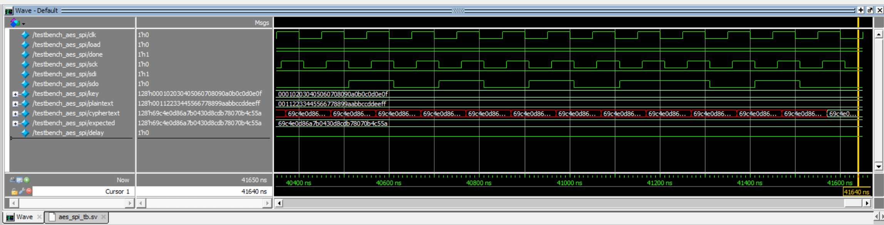
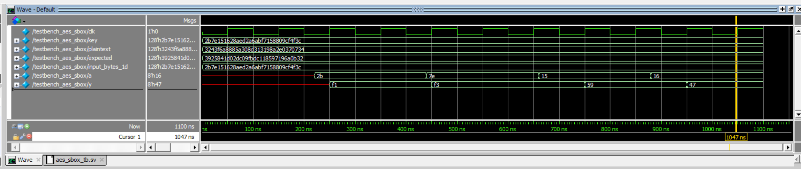
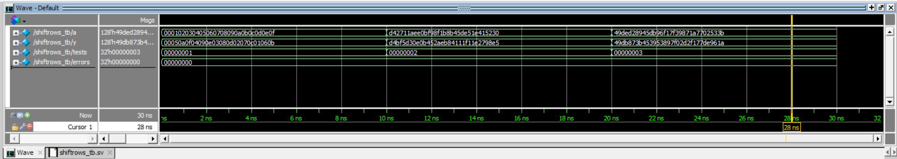
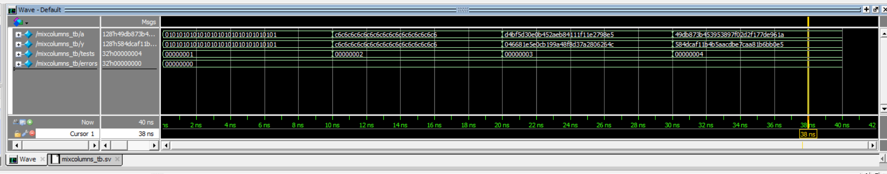
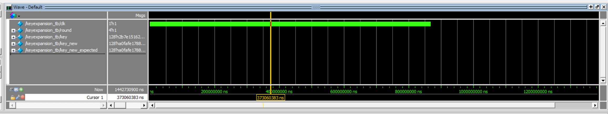
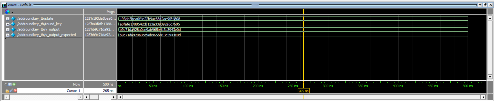

## Lab 7: The Advanced Encryption Standard

### Introduction

In this lab, I designed and implemented an interface to communicate between the FPGA and MCU. I had to implement the AES Standard algorithm, specifically the cipher and key expansion functions, in order to get this to work.

### Design and Testing Methodology

When it comes to designing, most of the time was spent thinking about how variables worked in the AES standard. The datasheet was very dense, so it took a long time to process everything and remember the terminology. After processing the datasheet, I implemented the cipher and key expansion functions in SystemVerilog. A lot of this was combinational logic, and also using an FSM to control how many times and when these functions run.

#### Testing the Design
To test the design, I used testbenches and the Simulation Wizard. I tested all submodules under aes_core and also the spi module. All of them passed!

### Technical Documentation

The source code for this lab can be found in [this GitHub repository](https://github.com/eing523/e155-lab7).

#### Block Diagrams

::: {.callout-note collapse="true"}
## Top Module Block Diagram

Figure 1: Block diagram of the top module design.
:::

The block diagram in [Figure 1](images/aes_top_blockdiagram.jpeg) demonstrates how the top module brings the aes_core and aes_spi modules together.

::: {.callout-note collapse="true"}
## aes_core Module Block Diagram

Figure 2: Block diagram of the aes_core module.
:::

The block diagram in [Figure 2](images/aes_core_blockdiagram.jpeg) demonstrates the internal structure of the AES cipher module. Logic for keyexpansion, subbytes, shiftrows, mixcolumns, and addroundkey are all implemented in this module.

### Results and Discussion

#### Testbenches

::: {.callout-note collapse="true"}
## Core module (AES Cipher and Keyexpansion) functionality

Figure 3: Simulation waveforms for the core module. 

:::
The waveforms in [Figure 3](images/aes_core_tb.png) show a successful testbench run for the core module functionality.

::: {.callout-note collapse="true"}
## SPI functionality

Figure 4: Simulation waveforms for the SPI functionality.
:::
The waveforms in [Figure 4](images/aes_spi_tb.png) show a successful testbench run for the SPI functionality.

::: {.callout-note collapse="true"}
## Subbytes (sbox_sync) functionality

Figure 5: Simulation waveforms for the sbox_sync functionality.
:::
The waveforms in [Figure 5](images/aes_sbox_tb.png) show a successful testbench run for the Subbtyes functionality. Subbytes is just instantiating sbox_sync 16 times, so just showing that sbox_sync works is enough to show that Subbytes is working.

::: {.callout-note collapse="true"}
## Shiftrows functionality

Figure 6: Simulation waveforms for the Shiftrows functionality.
:::
The waveforms in [Figure 6](images/shiftrows_tb.png) show a successful testbench run for the Shiftrows functionality.

::: {.callout-note collapse="true"}
## Mixcolumns functionality

Figure 7: Simulation waveforms for the Mixcolumns functionality.
:::
The waveforms in [Figure 7](images/mixcolumns_tb.png) show a successful testbench run for the Mixcolumns functionality.

::: {.callout-note collapse="true"}
## Keyexpansion functionality GET BETTER SCREENSHOT

Figure 8: Simulation waveforms for the Keyexpansion functionality.
:::
The waveforms in [Figure 8](images/keyexpansion_tb.png) show a successful testbench run for the Keyexpansion functionality.

::: {.callout-note collapse="true"}
## Addroundkey functionality

Figure 9: Simulation waveforms for the Addroundkey functionality.
:::
The waveforms in [Figure 9](images/addroundkey_tb.png) show a successful testbench run for the Addroundkey functionality.

 
### Conclusion

Using SystemVerilog and Lattice Radiant, I was able to create code that implements the AES encryption algorithm correctly. The FPGA and MCU are able to communicate by downloading both codes to the respective devices.

One thing I would like to note is that all of my testbenches passed, but the hardware was not working. This is because the LED that indicates a failed communication blinked. This is very interesting to me because the hardware would work completely if the testbenches worked completely in previous labs. I couldn't exactly figure out why this was happening. One guess is that it could be an issue with the timing in the FSM.

The design meets all the proficiency requirements. Overall, the lab was a mostly a success!

I spent a total of 30 hours working on this lab.

### AI Prototype Summary

I used Gemini for this exercise. I noticed for the first prompt, when I synthesized the design in Radiant, that it was a success; the warnings/errors thrown were only because I told it to assume that RotWord was already created (and my project didn't have RotWord in it). This result was the same for the second prompt. The main differences between the two responses were that the first prompt's response was much more simpler and easy to understand, while the second prompt's response felt overwhelming and followed the prompted structure very closely. From this exercise, I learned that providing a rigid structure for the AI to follow can allow them to follow it very literally, rather than finding more optimal, simpler solutions.